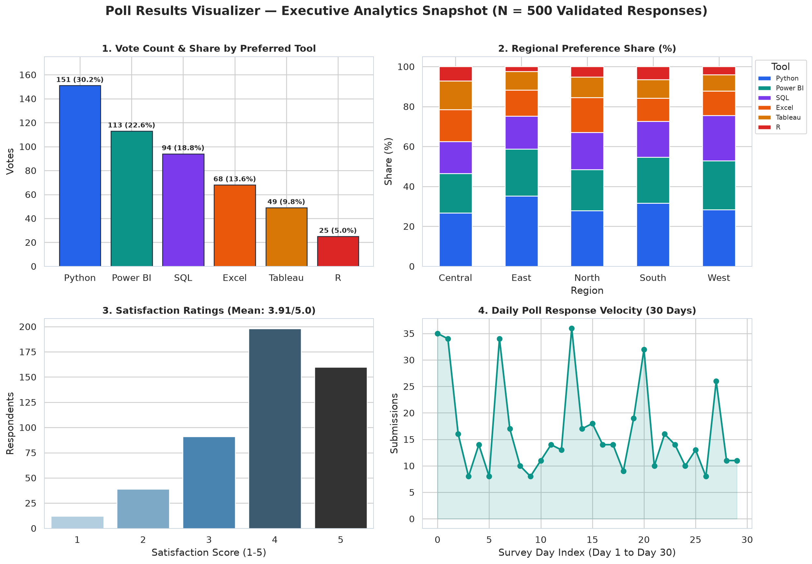
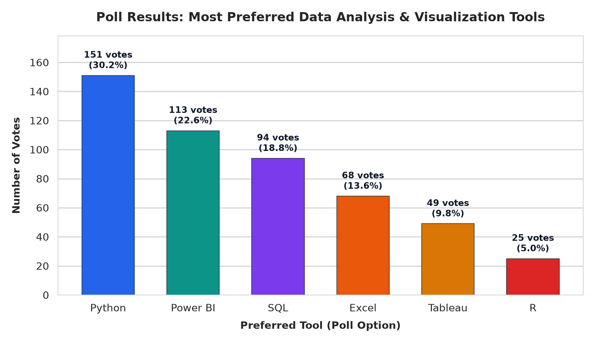
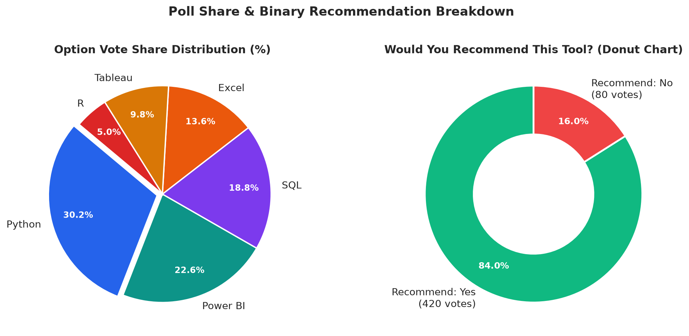
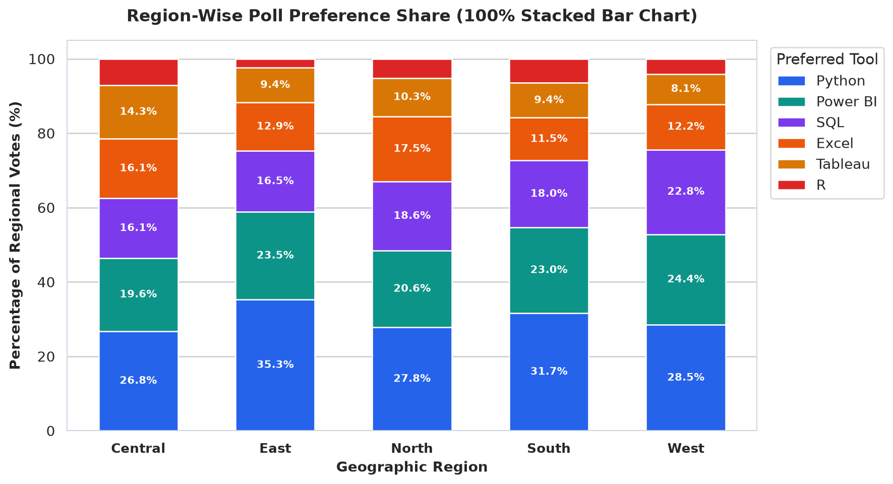
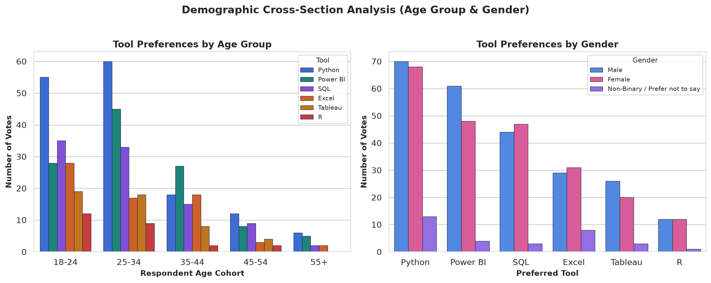
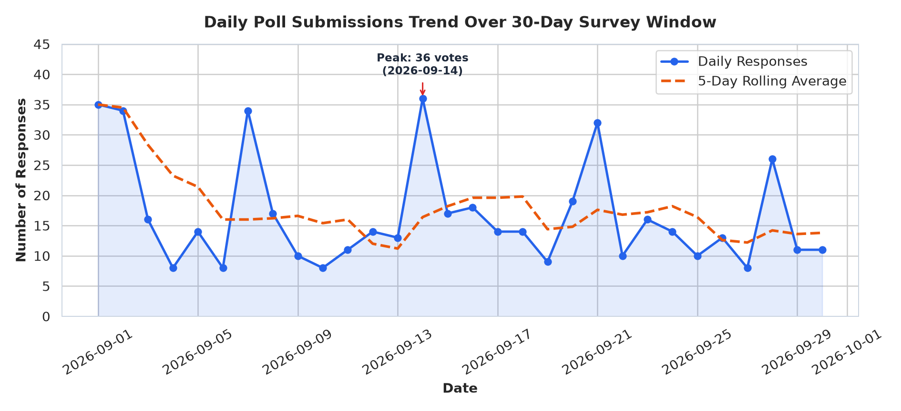
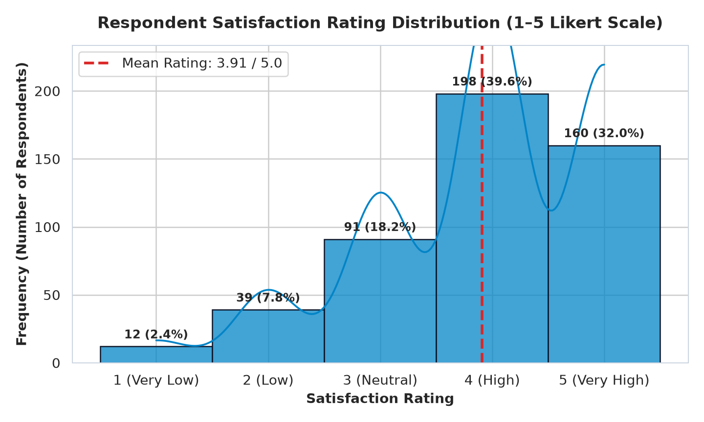
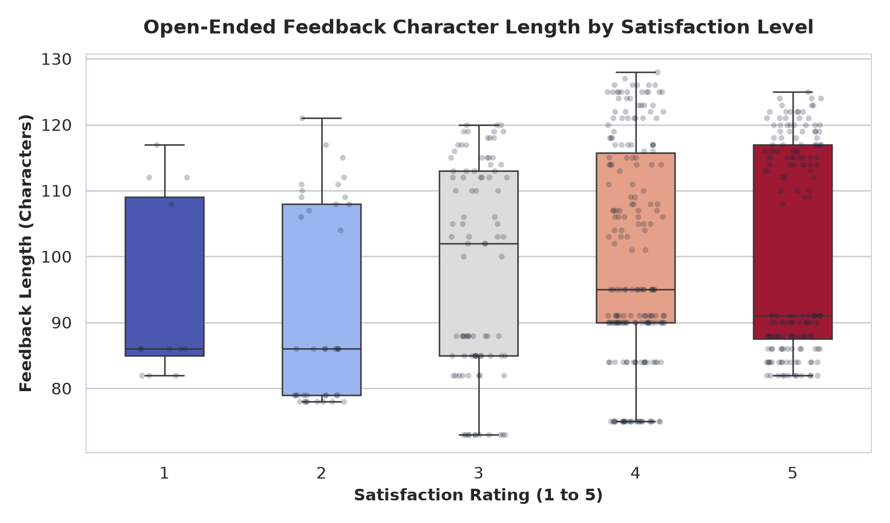
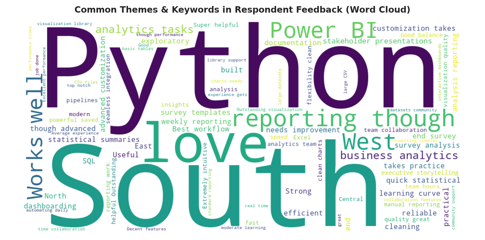

# 📊 Poll Results Visualizer

[](https://www.python.org/)
[](https://pandas.pydata.org/)
[](https://seaborn.pydata.org/)
[](https://plotly.com/)
[](https://streamlit.io/)
[](https://opensource.org/licenses/MIT)

> **An end-to-end, industry-oriented Survey & Poll Analytics Pipeline and Interactive Streamlit Web Dashboard.**  
> Built for **Data Analyst, Business Analyst, Research Analyst, and Insights Analyst** portfolios.

---

## 📌 1. Project Overview

Organizations across market research, civic polling, product management, human resources, and education collect thousands of poll and survey responses via **Google Forms, SurveyMonkey, Qualtrics, Typeform, or CSV exports**. However, raw tabular survey exports contain duplicate submissions, missing values, inconsistent text formatting (`"  python "`, `"PYTHON"`, `"Power Bi"`), and unstructured open-ended feedback that take hours to summarize manually.

**Poll Results Visualizer** automates the entire workflow:
1. **Ingests** raw survey/poll CSV exports or generates realistic synthetic poll datasets with demographic, regional, Likert-scale (`1–5`), binary (`Yes/No`), and open-ended text fields.
2. **Cleans & Preprocesses** messy records (deduplication, missing-value handling, text standardization, datetime parsing, and feature engineering such as `Feedback Length` and `Sentiment`).
3. **Analyzes** option-wise vote counts, percentage share (`%`), cumulative share, regional cross-tabulations, demographic cohorts (`Age Group`, `Gender`, `Role`), and daily response velocity.
4. **Visualizes** results across **9 publication-grade charts** (Bar, Pie/Donut, 100% Stacked Regional Bar, Demographic Grouped Bar, Daily Trend Line, Satisfaction Histogram + KDE, Boxplot, Word Cloud, and 4-Panel Executive Summary).
5. **Deploys** an interactive **Streamlit Web Dashboard (`app.py`)** with live multi-dimensional filtering and one-click CSV report exports.

---

## 🎯 2. Problem Statement vs. Solution

| Challenge in Traditional Survey Analysis | How **Poll Results Visualizer** Solves It |
| :--- | :--- |
| **Dirty Raw Exports:** Double-clicked form submissions, blank fields, and inconsistent capitalization (`"sql"` vs `"SQL"`). | Automated **Data Hygiene Pipeline (`src/data_cleaner.py`)** removes duplicates, drops incomplete critical rows, and standardizes categories. |
| **Static, One-Dimensional Tallies:** Knowing who won overall hides *which region* or *which age group* drove the result. | **Multi-Dimensional Cross-Tab Engine (`src/analyzer.py`)** computes regional shares, demographic splits, and satisfaction scores per option. |
| **Unstructured Open-Ended Text:** Hundreds of free-text comments go unread because manual coding is slow. | **NLP Word Cloud & Sentiment Classifier** extracts top keywords and classifies feedback into *Positive*, *Neutral*, or *Constructive/Negative*. |
| **Slow Manual Reporting:** Copy-pasting Excel charts into slides every week wastes 60%+ of analyst time. | **One-Command CLI (`python main.py`) + Live Streamlit App (`streamlit run app.py`)** regenerates all charts, tables, and executive reports instantly. |

---

## ✨ 3. Key Features

- **Automated Data Cleaning & Audit Logging:** Tracks exact row counts before and after deduplication (`12` duplicates removed), missing-value filtering (`13` incomplete rows removed), and category normalization (`20` noisy variants consolidated into `6` canonical options).
- **Comprehensive Statistical Aggregation:** Computes Vote Count, Vote Share (`%`), Cumulative Share (`%`), Mean & Median Satisfaction (`1–5`), Recommendation Approval Rate (`% Yes`), and Average Feedback Length.
- **9 Publication-Quality Static Visualizations:** Automatically exported at 180 DPI to `images/`.
- **Interactive Streamlit Web Application (`app.py`):**
  - Upload any custom CSV or explore the 500-respondent benchmark dataset.
  - Filter dynamically by **Preferred Tool, Region, Age Group, Gender, and Satisfaction Rating**.
  - Explore 5 dedicated analytics tabs with interactive Plotly & Seaborn charts, live Word Cloud generation, and CSV download buttons.
- **Optional Hardware Extension (`src/esp32_poll_counter.ino`):** Includes Arduino/ESP32 sketch for physical push-button polling stations over USB Serial.

---

## 🛠️ 4. Tech Stack

| Layer | Technologies Used | Purpose |
| :--- | :--- | :--- |
| **Programming Language** | `Python 3.9+` | Core scripting, modular pipeline architecture |
| **Data Manipulation** | `pandas`, `numpy` | DataFrame cleaning, cross-tabulation, percentage & KPI math |
| **Static Visualization** | `matplotlib`, `seaborn` | High-resolution bar, pie, donut, stacked, boxplot, and KDE charts |
| **Interactive Visualization** | `plotly.express` | Zoomable, hover-enabled web charts inside Streamlit |
| **Text / NLP Visualization** | `wordcloud`, `nltk` | Keyword extraction, stopword filtering, and Word Cloud rendering |
| **Web Dashboard** | `streamlit` | Interactive browser-based BI application with sidebar filters |
| **Notebooks & Docs** | `Jupyter Notebook`, `tabulate` | Interactive EDA walkthrough and Markdown report generation |

---

## 📂 5. Project Folder Structure

```text
Poll-Results-Visualizer/
│
├── data/
│   ├── poll_data.csv                  # Raw poll dataset (525 rows with realistic noise)
│   └── cleaned_poll_data.csv          # Cleaned & feature-engineered dataset (500 valid rows)
│
├── notebooks/
│   └── poll_analysis_walkthrough.ipynb # Step-by-step Jupyter Notebook for EDA & visualization
│
├── src/
│   ├── __init__.py                    # Package initializer
│   ├── data_generator.py              # Synthetic survey generator with regional/demographic patterns
│   ├── data_cleaner.py                # Deduplication, missing data handling, text standardization
│   ├── analyzer.py                    # Vote share %, regional/demographic cross-tabs, report writer
│   ├── visualizer.py                  # Generates all 9 high-resolution charts in images/
│   └── esp32_poll_counter.ino         # Optional ESP32 hardware button vote counter sketch
│
├── outputs/
│   ├── vote_share_summary.csv         # Option-wise votes, share %, satisfaction & recommend rate
│   ├── regional_breakdown.csv         # Region-wise leading tool and percentage distribution
│   ├── demographic_breakdown.csv      # Age Group, Gender, and Role segment breakdown
│   └── executive_insights_report.md   # Auto-generated Markdown executive report
│
├── images/
│   ├── 01_preferred_tool_bar_chart.png
│   ├── 02_vote_share_pie_donut.png
│   ├── 03_regional_preference_stacked.png
│   ├── 04_demographic_age_gender_chart.png
│   ├── 05_daily_submissions_trend.png
│   ├── 06_satisfaction_distribution.png
│   ├── 07_feedback_length_vs_satisfaction_boxplot.png
│   ├── 08_feedback_wordcloud.png
│   └── 09_executive_dashboard_summary.png
│
├── app.py                             # Interactive Streamlit Web Dashboard
├── main.py                            # End-to-end CLI pipeline runner
├── PROJECT_GUIDE.md                   # Complete 16-section student & interview handbook
├── requirements.txt                   # Python library dependencies
└── README.md                          # Project documentation
```

---

## 🚀 6. How to Run the Project

### Step 1: Clone the Repository
```bash
git clone https://github.com/your-username/Poll-Results-Visualizer.git
cd Poll-Results-Visualizer
```

### Step 2: Create a Virtual Environment & Install Dependencies
```bash
# Windows
python -m venv venv
venv\Scripts\activate

# macOS / Linux
python3 -m venv venv
source venv/bin/activate

# Install required packages
pip install -r requirements.txt
```

### Step 3: Run the Automated Analytics & Chart Pipeline
```bash
python main.py
```
*This generates `data/poll_data.csv`, cleans it into `data/cleaned_poll_data.csv`, exports summary CSVs + `outputs/executive_insights_report.md`, and saves all 9 charts into `images/`.*

### Step 4: Launch the Interactive Streamlit Dashboard
```bash
streamlit run app.py
```
*Open `http://localhost:8501` in your browser to interact with live filters, charts, and data exports.*

---

## 📈 7. Key Results & Benchmark Insights (`N = 500` Validated Responses)

### Option-Wise Vote Share Summary
| Rank | Preferred Tool | Votes | Vote Share (%) | Cumulative Share (%) | Avg Satisfaction (1–5) | Recommend Rate (% Yes) | Avg Feedback Length (Chars) |
| :---: | :--- | :---: | :---: | :---: | :---: | :---: | :---: |
| **1** | **Python** | **151** | **30.20%** | 30.20% | 4.05 | 91.39% | 102.1 |
| **2** | **Power BI** | **113** | **22.60%** | 52.80% | **4.10** | 86.73% | 101.2 |
| **3** | **SQL** | **94** | **18.80%** | **71.60%** | 3.85 | 81.91% | 96.5 |
| **4** | **Excel** | **68** | **13.60%** | 85.20% | 3.50 | 69.12% | 99.1 |
| **5** | **Tableau** | **49** | **9.80%** | 95.00% | 4.08 | **91.84%** | 94.0 |
| **6** | **R** | **25** | **5.00%** | 100.00% | 3.20 | 60.00% | 96.8 |

### Headline Takeaways
- 🏆 **Clear Market Leader:** **Python** leads overall with **30.2% vote share (151 votes)**, beating runner-up **Power BI (22.6%, 113 votes)** by **+38 votes (+7.6 percentage points)**.
- 📊 **Top-3 Consolidation:** **Python, Power BI, and SQL** together capture **71.6%** of all respondent preferences.
- 🌍 **Regional Consistency:** **South (27.8% of total responses)** and **West (24.6%)** are the most active regions; Python leads in all 5 regions, peaking at **35.29% share in the East region**.
- ⭐ **High User Satisfaction:** Overall mean satisfaction is **3.91 / 5.00** with an **84.0% positive recommendation rate**.

---

## 🖼️ 8. Generated Visualizations Preview

### Executive 4-Panel Analytics Snapshot


### Most Preferred Tools (Bar Chart)


### Vote Share Pie Chart & Recommendation Donut Chart


### Region-Wise Preference Comparison (100% Stacked Bar Chart)


### Demographic Cross-Section (Age Group & Gender)


### Daily Poll Submissions Trend (30-Day Window)


### Satisfaction Rating Distribution (Histogram + KDE)


### Feedback Length by Satisfaction Level (Boxplot)


### Open-Ended Feedback Word Cloud


---

## 📜 License
This project is licensed under the MIT License — free for academic, portfolio, and commercial use.
